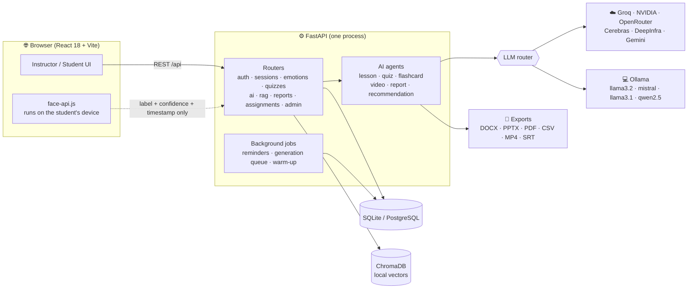
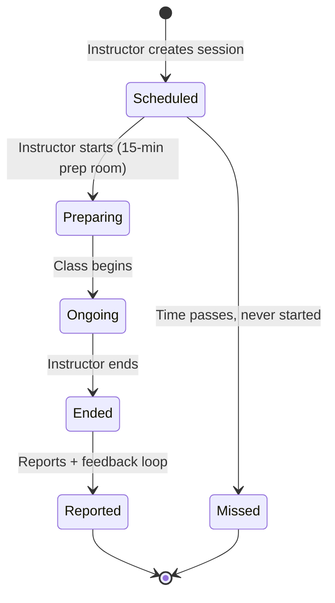
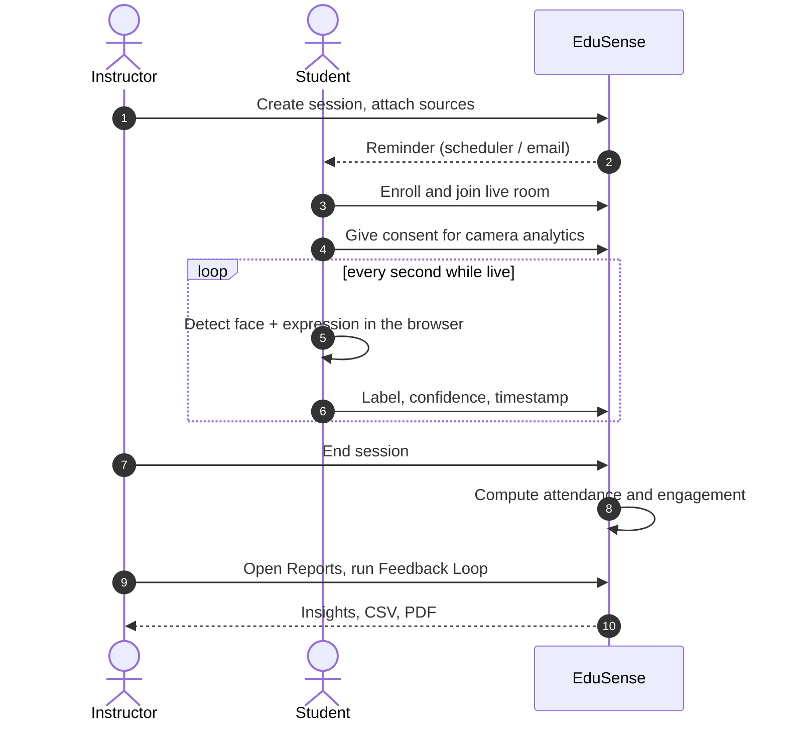
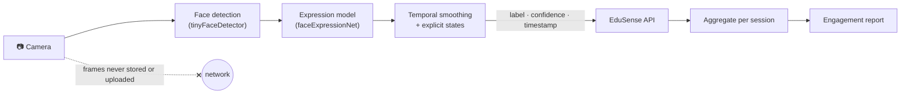
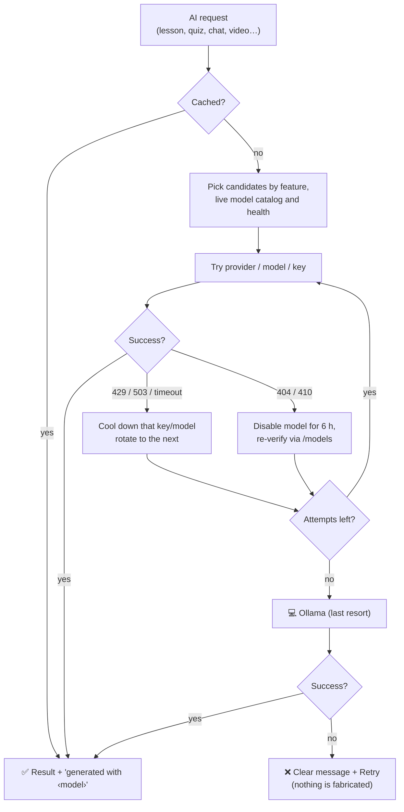
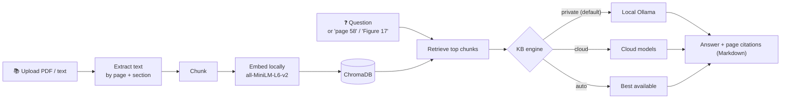
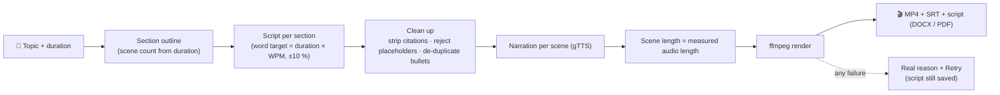
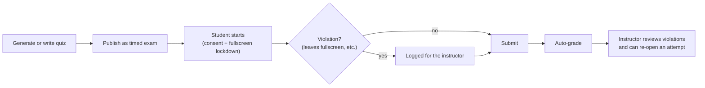
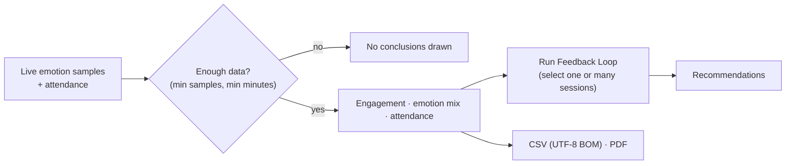

<div align="center">

# 🎓 EduSense

### The AI classroom platform that reads the room — privately.

Live sessions · AI lessons, quizzes, flashcards & videos · a private knowledge base · real-time engagement analytics — all on **one machine**, with **no student camera frame ever leaving the browser**.

<br/>


[**Quick start**](#-quick-start) · [**Features**](#-features) · [**Workflows**](#-how-it-works) · [**AI engine**](#-the-ai-engine) · [**Configuration**](#-configuration) · [**Troubleshooting**](#-troubleshooting) · [**Honest limits**](#-honest-limits)

</div>

---

## ✨ What is EduSense?

EduSense is a self-hosted teaching platform for instructors and students. An instructor runs a live session, generates teaching material with AI, and sees — after class — how engaged the room really was. Students join, learn, take exams and review their history.

|  |  |
|---|---|
| 🧠 **AI that teaches** | Lessons (English + Arabic), quizzes, flashcards, narrated videos and a chatbot, generated by a pool of cloud models with a local fallback. |
| 📚 **Your own library** | Upload a book, ask questions, paste a passage. Answers come with **page and section citations**, computed locally. |
| 🙂 **Engagement analytics** | Face detection and expression recognition run **inside the student's browser**. Only a label, a confidence and a timestamp are sent. |
| 📴 **Works offline** | One online setup, then everything runs without internet using a local model (Ollama). |
| 🛡️ **Honest by design** | When every AI engine is down, the app says so and offers a Retry. It never fabricates content. |

---

## 🚀 Quick start

> Windows machine · about 5 minutes · internet needed **once**

1. **Install**
   - **Python 3.11+** (tick *Add python.exe to PATH*) and **Node.js 18+**
   - Optional: [**Ollama**](https://ollama.com) then `ollama pull llama3.2` for offline AI
   - Optional: **ffmpeg** on PATH for MP4 video export
2. **Double-click `start-all.bat`.** It creates `backend/.venv`, installs the pinned dependencies, copies `backend/.env.example` to `backend/.env`, prepares the database, starts the API on port **8000** and the web app on **5173**, then opens your browser.
3. **Sign in** with one of the demo accounts below, then open **http://localhost:5173**.

   | Role | Email | Password |
   |---|---|---|
   | 👩‍🏫 Instructor | `instructor@edusense.local` | `Password123` |
   | 🎒 Student | `student@edusense.local` | `Password123` |

   > ⚠️ These are **local trial accounts** created by the seed script for testing only. Never use them on a real or public deployment. Change `EDUSENSE_SECRET_KEY` in `backend/.env` and create your own users before any real use.

<details>
<summary><b>📴 Running fully offline after the first run</b></summary>

<br/>

The first run downloads Python packages, the embedding model and fonts, so it needs internet. After that:

- Create an empty file named **`OFFLINE`** next to `start-all.bat` (or set `EDUSENSE_OFFLINE=1`). The launcher then stops pip and Hugging Face from contacting the network.
- Start Ollama with `llama3.2` for AI features. Cloud providers are skipped automatically.
- **Still needs internet:** cloud models, web-search citations in the chatbot, and video narration (gTTS).
- If you move the project folder to another PC, the virtual environment must be rebuilt once online.

</details>

<details>
<summary><b>🔌 One fixed port, no surprises</b></summary>

<br/>

The API always uses **one port** (`EDUSENSE_PORT`, default 8000). If it is busy, the launcher stops a stale EduSense server, or exits with the exact reason. It never silently moves the API to another port.

</details>

---

## 🧩 Features

### 👩‍🏫 Instructor

| Area | What you get |
|---|---|
| **Dashboard** | Your sessions, attendees, and **Run Feedback Loop**: select sessions and get recommendations built from real session data. |
| **Sessions** | Create, edit, start (with a 15-minute prep room), end, and manage resources. |
| **Sources** | Upload PDFs and notes, tag them to sessions; students download them. |
| **Knowledge Base** | Local RAG over your books. Ask, or paste a passage; answers are Markdown with page and section citations. Nothing calls an LLM just to load the library. |
| **AI Lessons** | Structured lessons in English and Arabic, exportable to **DOCX, PPTX and PDF**. |
| **Quizzes** | Write them manually or generate them; publish as a timed **exam** with fullscreen lockdown. |
| **Flashcards** | Generated with the exact count you ask for. |
| **Videos** | Script + narration + **MP4** with an in-app player, subtitles (SRT) and script downloads. |
| **AI Chatbot** | Answers with numbered web citations and style controls. |
| **Reports** | Per-session attendance, emotion distribution and engagement; **CSV (UTF-8 BOM)** and **PDF**. Reports refuse to draw conclusions from too little data. |

### 🎒 Student

- Dashboard, upcoming sessions, browse and enroll, **live session room**, history, resources
- **Exams**: take, submit, see the result; **assignments** with file upload
- **Emotion Recognition Trial**: try the same detector used in live sessions, entirely in your browser
- English and Arabic interface, light and dark theme

### 🛠️ Admin

- Users and roles, database preview (allow-listed tables only), and an AI-engine status endpoint

---

## 🔄 How it works

### 1. System overview



### 2. A session from start to finish





### 3. Privacy-first emotion analytics



States shown to the student: *starting · no face · too dark · uncertain · result* (with a confidence bar and the top 3 emotions). Consent is required before analysis starts, and camera tracks stop when you leave the page.

### 4. The AI engine: routing and fallback



### 5. Knowledge Base (RAG)



### 6. Video generation



### 7. Exams with integrity checks



### 8. Reports and the feedback loop



---

## 🤖 The AI engine

- **Live model discovery.** Each API key's `/models` list is probed once, filtered to general chat/instruct models, cached in `backend/data/llm_models.json`, and only working models are offered. Retired model names are never hardcoded.
- **Many keys, many models.** Add several keys per provider. Keys rotate on quota or overload errors, and different keys can serve different models.
- **Circuit breaker.** A request tries a bounded number of provider/model pairs, then falls back, and failures show a short readable message, never the provider's raw error.
- **Local last resort.** Ollama is always the final fallback. Models are ordered fast-first (`llama3.2` before the larger ones) so a CPU-only machine can still answer.
- **Transparent.** Results show which model produced them.

---

## ⚙️ Configuration

Everything lives in `backend/.env` (created from `backend/.env.example` on first run).

<details>
<summary><b>Core settings</b></summary>

<br/>

| Variable | Purpose |
|---|---|
| `EDUSENSE_PORT` | API port (default 8000, one fixed port) |
| `EDUSENSE_DATABASE_URL` | SQLAlchemy URL. SQLite by default, PostgreSQL supported |
| `EDUSENSE_SECRET_KEY` | JWT signing secret. **Set your own before real use** |
| `EDUSENSE_CORS_ORIGINS` / `EDUSENSE_FRONTEND_URL` | Allowed web origins and the link used in emails |
| `KB_ENGINE` | `private` (local only, **default**), `cloud`, or `auto` |
| `EDUSENSE_OLLAMA_URL` / `EDUSENSE_OLLAMA_MODEL` | Local Ollama endpoint and default local model |
| `EDUSENSE_ENGAGEMENT_THRESHOLD` | Engagement level below which feedback suggests changes |

</details>

<details>
<summary><b>AI provider keys (all optional)</b></summary>

<br/>

Use one comma-separated list per provider, for example `GROQ_API_KEYS=key1,key2`. Supported: `GROQ`, `NVIDIA`, `OPENROUTER`, `CEREBRAS`, `DEEPINFRA`, `GEMINI`. Never commit real keys; `.env` is git-ignored. Without any key, AI uses Ollama when it is running; otherwise AI tools say *"AI engine not configured"* and everything else keeps working.

</details>

<details>
<summary><b>Video, reports and email</b></summary>

<br/>

| Variable | Purpose |
|---|---|
| `EDUSENSE_VIDEO_NARRATION_WPM` | Words per minute used to turn a duration into a script length |
| `EDUSENSE_VIDEO_SCRIPT_TOLERANCE` | Allowed script-length deviation (0.10 = ±10 %) |
| `EDUSENSE_VIDEO_TTS_TIMEOUT` | Per-scene narration timeout |
| `EDUSENSE_REPORT_MIN_EMOTION_SAMPLES` / `_MIN_ATTENDED_MINUTES` / `_MIN_PARTICIPANTS` | Minimum data before a report draws conclusions |
| `EDUSENSE_REPORT_MAX_ATTENDED_MINUTES` | Sanity cap on attended time |
| `EDUSENSE_SMTP_*` | Reminder emails (use an app password, never your account password) |

</details>

---

## 🗂️ Project structure

```text
Edusense/
├── start-all.bat          # one-click launcher (API + web app)
├── install-local.bat      # manual dependency install
├── backend/
│   ├── app/
│   │   ├── api/           # routers: auth, sessions, emotions, quizzes, ai, rag, reports…
│   │   ├── agents/        # lesson, quiz, flashcard, report, recommendation, orchestrator
│   │   ├── services/      # llm router, rag, video, vector store, exports, ingestion
│   │   ├── core/          # config, scheduler, auditing, security
│   │   ├── db/ models/ schemas/
│   │   └── tools/         # diagnostics (python -m app.tools.doctor)
│   └── tests/             # automated tests
├── frontend/
│   ├── public/models/     # face-api.js models (work offline)
│   └── src/               # pages, components, styles
├── docs/                  # user guide, privacy policy, terms
└── CHANGELOG.md
```

---

## 🧪 Tests

```bat
cd backend
.venv\Scripts\python.exe -m pytest -m "not live_provider"
```

Tests marked `live_provider` call real AI services and are skipped by default.

---

## 🩺 Troubleshooting

<details>
<summary><b>Click to expand</b></summary>

<br/>

| Symptom | Fix |
|---|---|
| `Port 8000 is still in use by PID …` | The launcher names the process. Stop it, or set `EDUSENSE_PORT` in `backend/.env` |
| API window closes immediately | Read the error above the banner, then run `backend\.venv\Scripts\python.exe -m app.tools.doctor` |
| "Cannot reach the backend" | Open `http://localhost:8000/health`; make sure `backend\.env` has no old port override |
| Camera permission denied | Padlock icon → allow camera → *Retry camera*. Only one app can own the camera |
| "No face detected" / "Too dark" | Face the camera and add light in front of you; the badge tells you which state you are in |
| Slow AI answers | Local 8B models spill to CPU on a 4 GB GPU. Use `llama3.2`, or add a free cloud key |
| Knowledge Base says the embedding model is not cached | Connect to the internet once so it can download, then you can go offline |
| Video has a script but no MP4 | Install **ffmpeg** and add it to PATH, then press Retry |
| Logs | `backend\logs\edusense.log` (rotating, 10 MB × 5) |

</details>

---

## ⚖️ Honest limits

- Cloud free tiers have daily and per-minute quotas. When they run out, requests fall back to local Ollama, which is much slower on a 4 GB GPU (about 13 tokens/s for `llama3.2`, 1–2 tokens/s for 8B models).
- Emotion recognition uses a small, older model. Accuracy depends on lighting, camera angle and face size. It says "uncertain" rather than guessing, and it is **not** a medical or psychological measurement.
- The live-session screen share streams JPEG snapshots (about every 2 s), not real WebRTC video.
- Video narration needs internet (gTTS) and MP4 export needs ffmpeg; without them you still get the script and scenes.
- Single-machine deployment: one API process, SQLite by default. It is not a multi-tenant cloud service.

---

## 🔐 Privacy

No camera image is stored or uploaded. Only an emotion label, a confidence value and a timestamp are sent, and only after consent. See [`docs/PRIVACY_POLICY.md`](docs/PRIVACY_POLICY.md) and [`docs/TERMS_OF_SERVICE.md`](docs/TERMS_OF_SERVICE.md).

---

## 🙏 Credits and licences

- Face detection and expressions: [@vladmandic/face-api](https://github.com/vladmandic/face-api) (MIT)
- FastAPI, SQLAlchemy, Pydantic, uvicorn, APScheduler (MIT/BSD)
- React, Vite, React Router, Recharts, lucide-react (MIT)
- ChromaDB, sentence-transformers, PyPDF, python-docx, python-pptx, reportlab, gTTS, ffmpeg (their respective open-source licences)
- Ollama and the local models carry their own model licences

<div align="center">

**EduSense** · MIT licensed · Built by [Adel Mohamed Noufal](https://github.com/adel-noufal)

Version history: [`CHANGELOG.md`](CHANGELOG.md)

</div>