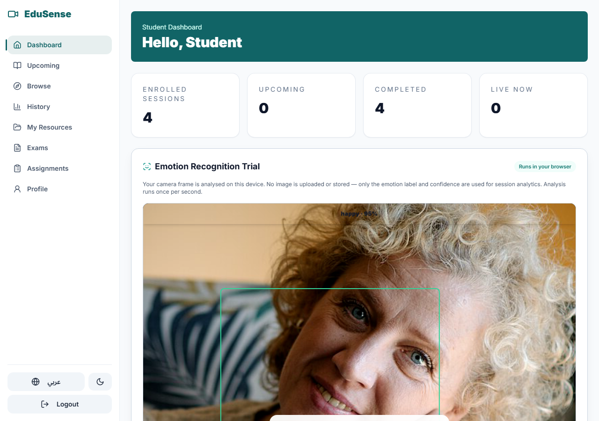

# EduSense — AI Education Platform

EduSense is a self-hosted teaching platform: live sessions, AI lesson/quiz/flashcard/video
generation, a local knowledge base (RAG), reports, and **in-browser** facial emotion
analytics for classroom engagement. It runs on one Windows machine with Python and Node,
works offline with a local LLM, and never uploads a student's camera frame.



## Quick start (3 steps)

1. Install **Python 3.11+** (tick “Add python.exe to PATH”) and **Node.js 18+**.
   Optional: [Ollama](https://ollama.com) with `ollama pull llama3.2` for offline AI,
   and **ffmpeg** on PATH for video export.
2. Double-click **`start-all.bat`**.
   It creates `backend/.venv`, installs the pinned dependencies, copies
   `backend/.env.example` to `backend/.env`, prepares the database, starts the API on
   port 8000 and the web app on 5173, then opens the browser.
3. Sign in. Accounts for this local installation are listed in
   [`docs/USER_GUIDE.md`](docs/USER_GUIDE.md) (local demo accounts only).

The API is always on **one fixed port** (`EDUSENSE_PORT` in `backend/.env`, default 8000).
If 8000 is busy the launcher stops a stale EduSense server, and otherwise exits with the
exact reason instead of silently moving the API to another port.

## Features

**Instructor**
- Dashboard with sessions, attendees and **Run Feedback Loop** (AI recommendations from real session data).
- Sessions: create, edit, start (15-minute prep room), end, resources modal.
- Sources: upload PDFs/notes, tag them to sessions; students download them.
- Knowledge Base (local RAG): upload a book, ask questions, paste a passage, get answers with
  page/section citations rendered as Markdown. Zero LLM calls when the library loads.
- AI tools: lessons (English + Arabic), quizzes (manual or generated, publish as a timed exam),
  flashcards (exact count), videos (script + TTS + MP4 with player and downloads), AI chatbot
  with numbered web citations.
- Reports: per-session attendance, emotion distribution, engagement, CSV (UTF-8 BOM) and PDF.
- Exports: lesson downloads (DOCX, PPTX, PDF) are generated server-side from the one stored JSON.

**Student**
- Dashboard, upcoming/browse/enroll, live session room, history, resources, exams
  (take, submit, result), assignments, profile.
- **Emotion Recognition Trial** and live-session camera: face detection + expression
  recognition run *in this browser* with [face-api.js](https://github.com/vladmandic/face-api)
  (MIT). Models ship in `frontend/public/models` (≈520 KB), so it works offline.
  One analysis per second, temporal smoothing, explicit states (starting / no face / too dark /
  uncertain / result with confidence bar and top-3). Only the label, confidence and timestamp
  are sent to the API; **no image leaves the browser**. Tracks stop on unmount and tab switch.

## Architecture

```
Browser (React 18 + Vite)
  ├─ face-api.js (tinyFaceDetector + faceExpressionNet)  ← camera frames stay here
  └─ fetch → http://localhost:8000/api
                     │
              FastAPI (uvicorn, one process)
                ├─ routers: auth, users, sessions, emotions, quizzes, ai, rag, reports, admin, assignments
                ├─ SQLAlchemy → SQLite (default) / PostgreSQL (DATABASE_URL)
                ├─ ChromaDB + sentence-transformers → local RAG index (backend/data/chroma)
                ├─ LLM router → Groq / NVIDIA / OpenRouter / Cerebras / DeepInfra / Gemini / Ollama
                ├─ background jobs: APScheduler reminders, generation queue, warm-up thread
                └─ exports: reportlab (PDF), python-docx, python-pptx, ffmpeg + gTTS (video)
```

- The model catalog is discovered **live** per API key (`/models`), filtered to general
  chat/instruct models, probed once, cached in `backend/data/llm_models.json`, and only
  working models are offered. Retired model names are never hardcoded.
- Short tasks prefer working cloud providers, then local **llama3.2**. `mistral`,
  `llama3.1` and `qwen2.5` stay selectable and are labelled “slow on this PC”.
- When every engine is down, AI features say so with a Retry action and non-AI features
  keep working. Nothing is fabricated.

## Configuration (`backend/.env`)

| Variable | Purpose |
|---|---|
| `EDUSENSE_PORT` | API port (default 8000; one fixed port) |
| `DATABASE_URL` | SQLAlchemy URL (SQLite file by default) |
| `GROQ_API_KEYS`, `NVIDIA_API_KEYS`, `OPENROUTER_API_KEYS`, `GEMINI_API_KEYS`, `CEREBRAS_API_KEYS`, `DEEPINFRA_API_KEYS` | Comma-separated keys; each is probed live. Optional |
| `EDUSENSE_OLLAMA_URL` | Local Ollama endpoint (default `http://localhost:11434`) |
| `KB_ENGINE` | `private` (local only, default), `cloud`, or `auto` |
| `EDUSENSE_SECRET_KEY` | JWT signing secret; set your own before real use |
| `REQUEST_TIMEOUT_SECONDS` | Hard limit for one HTTP request (default 300) |

Without any API key the app still starts: AI uses Ollama when it is running, otherwise
AI tools show *“AI engine not configured”* and everything else works.

## Troubleshooting

| Symptom | Fix |
|---|---|
| `Port 8000 is still in use by PID …` | The launcher names the process. Stop it, or set `EDUSENSE_PORT` in `backend/.env`. |
| API window closes immediately | Read the error above the banner, then run `backend\.venv\Scripts\python.exe -m app.tools.doctor` |
| “Cannot reach the backend” | Check `http://localhost:8000/health`; make sure `backend\.env` has no old port override |
| Camera permission denied | Padlock icon → allow camera → “Retry camera”. Only one app can own the camera |
| “No face detected” / “Too dark” | Face the camera, add light in front of you; the badge tells you which state it is in |
| Slow AI answers | Local 8B models spill to CPU on a 4 GB GPU. Use `llama3.2`, or add a free cloud key |
| Logs | `backend\logs\edusense.log` (rotating, 10 MB × 5) |

## Tests

```bat
cd backend
.venv\Scripts\python.exe -m pytest -m "not live_provider"
```

## Honest limits

- Cloud free tiers have daily/per-minute quotas. When they run out, requests fall back to
  local Ollama, which is much slower on a 4 GB GPU (≈13 tok/s for llama3.2, 1–2 tok/s for 8B models).
- Emotion recognition is a small 2018-era model: accuracy depends on lighting, camera angle
  and face size. It reports “uncertain” rather than guessing, and it is not a medical or
  psychological measurement.
- The live session “screen share” streams JPEG snapshots (≈2 s), not real WebRTC video.
- Video export needs ffmpeg; without it the script and scenes are still produced but no MP4.
- Single-machine deployment: one API process, SQLite by default. It is not a multi-tenant cloud service.

## Credits / licences

- Face detection & expressions: [@vladmandic/face-api](https://github.com/vladmandic/face-api) — MIT.
- FastAPI, SQLAlchemy, Pydantic, uvicorn, APScheduler — MIT/BSD.
- React, Vite, React Router, Recharts, lucide-react — MIT.
- ChromaDB, sentence-transformers, PyPDF, python-docx, python-pptx, reportlab, gTTS, ffmpeg — respective open-source licences.
- Ollama and the local models carry their own model licences.
- Project code: MIT (see `LICENSE`).
