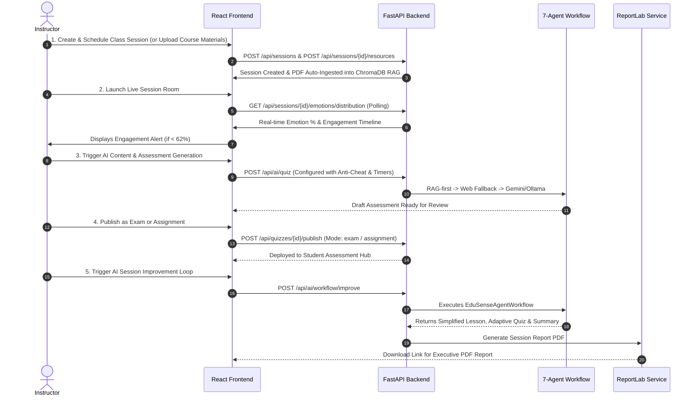
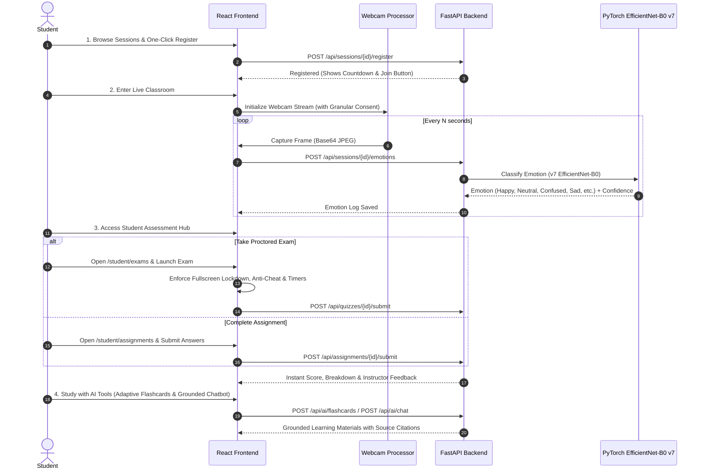
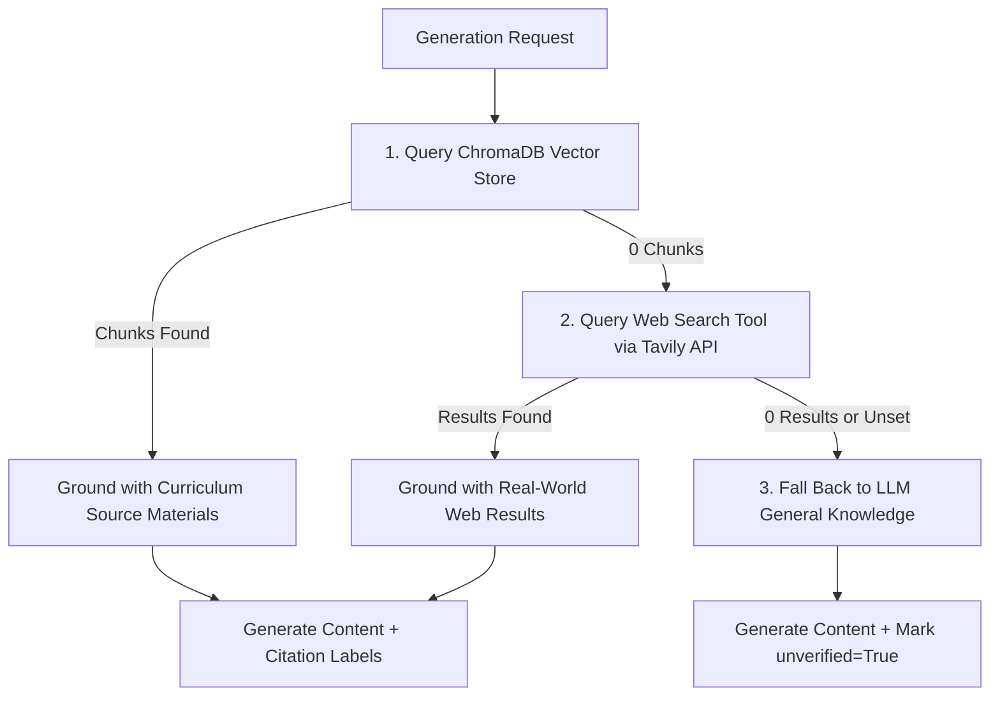
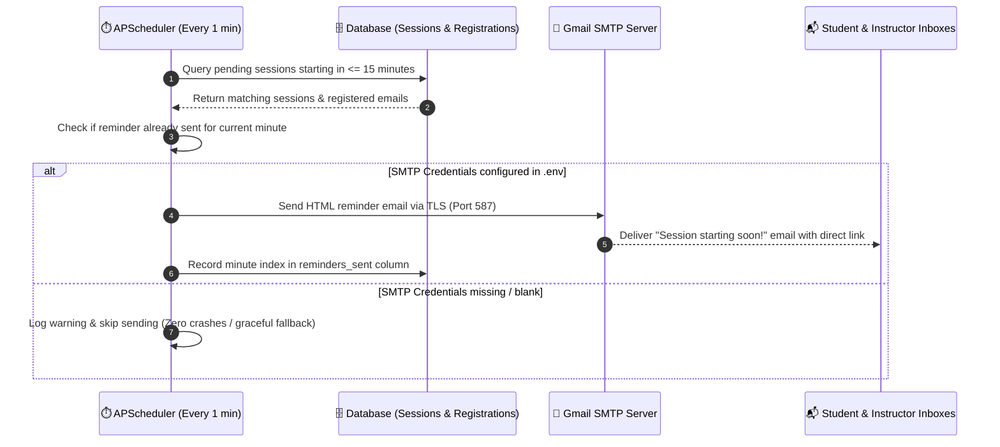

# 🎓 EduSense — Multi-Agent AI Education Platform

[](https://www.linkedin.com/in/adel-mohamed-noufal-3a9440348/)
[](https://www.linkedin.com/in/adel-mohamed-noufal-3a9440348/)
[-EE4C2C.svg?logo=pytorch)](https://github.com/adel-noufal/Edusense)
[](https://github.com/adel-noufal/Edusense)
[](https://github.com/adel-noufal/Edusense)
[](LICENSE)
[](CHANGELOG.md)
[](https://github.com/adel-noufal/Edusense/actions)

> **EduSense** is a fully local, multi-agent AI Education Platform designed for adaptive learning, automated lesson & assessment generation, real-time webcam emotion recognition, and interactive educational content creation.
>
> 👤 **Author:** [Adel Mohamed Noufal](https://www.linkedin.com/in/adel-mohamed-noufal-3a9440348/)  
> 🔗 **LinkedIn:** [https://www.linkedin.com/in/adel-mohamed-noufal-3a9440348/](https://www.linkedin.com/in/adel-mohamed-noufal-3a9440348/)  
> 🔗 **GitHub Repository:** [https://github.com/adel-noufal/Edusense](https://github.com/adel-noufal/Edusense)

---

## 🌟 Key Features & AI Architecture

EduSense runs **8 specialized AI agents**, coordinated sequentially by `EduSenseAgentWorkflow` ([`backend/app/agents/workflow.py`](file:///D:/Adel/Projects/Edusense%202/backend/app/agents/workflow.py)):

1. 🎭 **Emotion Analysis Agent** — Analyzes webcam frames in real-time using a custom **v7 PyTorch EfficientNet-B0** model (**90.9% Accuracy**) with DeepFace fallback.
2. 📊 **Student Engagement Agent** — Computes real-time engagement and attention metrics from emotion distributions.
3. 💡 **Recommendation Agent** — Generates pedagogical interventions when engagement drops below threshold (< 62%).
4. 📚 **Lesson Generation Agent** — Generates structured lessons, slides, outlines, and teaching scripts grounded in curriculum RAG and web search fallback.
5. 📝 **Quiz Generation Agent** — Generates adaptive MCQs, True/False, and short-answer questions (RAG & Web grounded) with instructor-configurable timers, anti-cheat lockdown, and direct deployment to student Exams/Assignments.
6. 🎴 **Flashcard Generation Agent** — Produces high-yield study flashcard decks grounded in uploaded curriculum materials and recent web context.
7. 📄 **Report Generation Agent** — Generates executive PDF reports via `ReportLab`.
8. 🧠 **RAG Knowledge Base & AI Chat Assistant** — Grounded PDF course material retrieval via ChromaDB vector embeddings, multi-source Chatbot (`POST /api/ai/chat`), interactive RAG Q&A (`POST /api/rag/ask`), instructor suggestions (`GET /api/rag/suggest`), and Knowledge Base Admin Dashboard (`/instructor/knowledge-base`).

---

## 🗺️ Roadmap

- ✅ **RAG System**: DONE — vector store (ChromaDB), dual ingestion paths (general `/api/rag/ingest` + auto-ingest on session resource upload), `RAG_Search_Tool`, RAG grounding in Lesson/Quiz/Flashcard agents (with `sources`/`unverified` badges), `Web_Search_Tool`, agent orchestrator with 4 failover states, chatbot (`/api/ai/chat`, rate-limited, with persisted conversation history), shared scope guardrail + audit logging across all LLM-calling agents (including the offline template fallback tier).
- ✅ **Security Hardening**: DONE — Argon2 password hashing (with backward-compatible fallback), role-based access control audited and enforced across every API endpoint, structured audit logging (database + file) for auth/sessions/reports/users/admin actions, rate limiting on auth and chat endpoints, `DISABLE_DEFAULT_ACCOUNTS` env flag for production, documented HTTPS/TLS deployment setup, CI security scanning (pip-audit, CodeQL, Trivy, TruffleHog).
- ✅ **Quiz Timer & Anti-Cheat**: DONE — per-quiz/per-question timers with server-side time validation, Quiz AI Agent Generator (`QuizAgentConfig` — reusable instructor presets for difficulty, question types, topic weighting, timer, and anti-cheat settings), fullscreen lockdown with exit-attempt detection (tab switch, window blur, fullscreen exit), dynamic traceable watermark overlay, optional camera-based second-device detection, instructor violation review with explicit re-entry approval (no auto re-enable).
- ✅ **Privacy & Consent**: DONE — granular webcam consent tracked separately per purpose (`emotion_detection` vs. `quiz_anti_cheat`), enforced server-side (not just hidden in the UI), declining consent never blocks non-camera platform access, draft Privacy Policy and Terms of Service (see `docs/PRIVACY_POLICY.md` and `docs/TERMS_OF_SERVICE.md` — **draft text, pending legal review before production use**, especially given minors are involved).
- ✅ **Session Registration & Live Flow Redesign**: DONE — seamless student session registration with live countdowns, friction-free join buttons for ongoing and imminent classes, instant status transitions, and real-time telemetry streaming without full-page reloads.
- ✅ **Dedicated Student Assessment Hub (Exams & Assignments)**: DONE — standalone student tabs for **Exams** (`/student/exams`) and **Assignments** (`/student/assignments`) with clear status badges, deadline tracking, full-screen proctored execution, and submission history.
- ✅ **Quiz Publishing & Exam Deployment**: DONE — instructors can create, fine-tune, and publish quizzes with instant conversion into formal Exams or Homework Assignments linked directly to course sessions.
- ✅ **Multi-API-Key Rotation for Google Gemini**: DONE — high-availability key rotation with automatic failover across comma-delimited or numbered environment keys (`GEMINI_API_KEY_1..N`), automatic recovery after cooldown expiry, and real-time key status monitoring via `/health`.
- ✅ **Web Search Grounding Beyond RAG**: DONE — 3-tier retrieval hierarchy (Curriculum RAG → Tavily Web Search → General Knowledge) wired across Lesson, Quiz, Flashcard, and Chatbot agents with source attribution citations and unverified content flags.
- 🔄 **Engagement Model**: IN PROGRESS — replacing the current emotion-classifier-derived engagement score with a separately trained, calibrated model (training underway on a dedicated dataset).

---

## 👨‍🏫 Instructor System Workflow



---

## 🎓 Student System Workflow



---

## 🎯 Student Assessment Hub: Exams & Assignments

EduSense provides dedicated, role-tailored portals for student assessments:

### 1. Proctored Exams (`/student/exams`)
- **Dedicated Student View**: Lists all published exams scheduled for enrolled courses or sessions.
- **Anti-Cheat Enforcement**:
  - Fullscreen lockdown mode with active detection of tab switching, window blurring, and fullscreen escape attempts.
  - Dynamic user-traceable watermark overlay across the screen.
  - Optional AI-assisted proctoring via webcam for violation detection.
- **Real-Time Timers**: Strict per-quiz and optional per-question timers with server-side validation to prevent tampering.
- **Submission & Results**: Immediate scoring for objective questions and violation auditing for instructor review.

### 2. Homework & Assignments (`/student/assignments`)
- **Self-Paced Assessments**: Lists pending and completed assignments with clear deadline indicators, point weights, and submission status.
- **Submission Workflow**: Supports rich-text answers, multiple-choice responses, and resource review.
- **Feedback & Grading**: Displays graded results, rubric breakdowns, and personalized instructor remarks.

---

## 🔄 Multi-API-Key Rotation for Google Gemini

To ensure high availability and prevent interruptions caused by free-tier rate limits (`HTTP 429` / `RESOURCE_EXHAUSTED` / Quota Exceeded), EduSense features an enterprise-grade key rotation and health monitoring engine:

### ⚙️ Configuration
You can supply multiple keys using either a single comma-separated variable or distinct numbered variables:

```env
# Comma-delimited list:
GEMINI_API_KEY=AIzaSyA1...,AIzaSyB2...,AIzaSyC3...

# OR numbered variables (automatically discovered):
GEMINI_API_KEY_1=AIzaSyA1...
GEMINI_API_KEY_2=AIzaSyB2...
GEMINI_API_KEY_3=AIzaSyC3...
```

### 🛡️ Rotation & Failover Mechanics
1. **Round-Robin Pool**: Requests cycle smoothly across all healthy configured API keys.
2. **Instant Failover on 429**: When a key encounters a rate limit or quota exhaustion, it is temporarily marked as exhausted and the request is immediately retried on the next available key without failing the user request.
3. **Automatic Cooldown Recovery**: Exhausted keys enter an exponential cooldown period (default: 60s) and automatically re-enter the active pool once the cooldown expires.
4. **Security Masking**: All key logging and status endpoints mask sensitive characters (e.g., `AIza...4f2a`).
5. **Real-Time Health Monitoring**: Inspect the key pool status anytime via the `/health` endpoint:
   ```json
   {
     "status": "healthy",
     "gemini_configured": true,
     "gemini_keys_count": 3,
     "gemini_keys_status": {
       "total_keys": 3,
       "active_keys": 3,
       "exhausted_keys": 0,
       "keys": [
         {"key_masked": "AIza...A1bC", "status": "active"},
         {"key_masked": "AIza...B2dE", "status": "active"},
         {"key_masked": "AIza...C3fG", "status": "active"}
       ]
     }
   }
   ```

---

## 🌐 Grounded Retrieval Pipeline: RAG + Web Search

All content-generating agents (**Lesson Generation**, **Quiz Generation**, **Flashcard Generation**, and **Chatbot Orchestrator**) follow a strict 3-tier retrieval hierarchy to guarantee factual accuracy and prevent hallucinations:



- **Curriculum RAG First**: Searches course PDFs and session documents stored in ChromaDB vector embeddings. Cites materials as `[Source: document.pdf p.N]`.
- **Web Search Fallback**: If no relevant curriculum documents exist, queries the Tavily Search API for verified, up-to-date web content. Cites sources as `[Web N: Title](url)`.
- **Graceful Offline Degradation**: If both RAG and Web Search are empty or unavailable, the agent generates content using general model knowledge, flags the result with `unverified: true`, and surfaces an unverified badge in the UI.
- **Tavily Configuration**:
  ```env
  EDUSENSE_TAVILY_API_KEY=tvly-your-tavily-api-key
  ```
  *(If unset, the web search tool gracefully returns empty results without crashing or throwing errors).*

---

## ⚡ Smart Multi-Tier AI System (Online + Multi-Model Offline)

EduSense features an **Intelligent Automatic Failover & Task Routing System**:

```text
                   ┌─────────────────────────────────────┐
                   │          AI Agent Request           │
                   └──────────────────┬──────────────────┘
                                      │
                    ┌─────────────────▼─────────────────┐
                    │ 🌐 Gemini 2.0 Flash (Online API)  │
                    └─────────────────┬─────────────────┘
                                      │  (If Offline / Connection Fails)
                    ┌─────────────────▼─────────────────┐
                    │ 🦙 Specialized Local Ollama LLMs  │
                    │ • Translation -> Qwen 2.5 (7B)    │
                    │ • Lessons     -> Mistral (7B)     │
                    │ • Quizzes     -> Llama 3.1 (8B)   │
                    │ • Flashcards  -> Llama 3.2 (3B)   │
                    └─────────────────┬─────────────────┘
                                      │  (If Ollama Unreachable)
                    ┌─────────────────▼─────────────────┐
                    │ ⚙️ Built-in Local Templates        │
                    └───────────────────────────────────┘
```

- **Online Mode (Default):** Uses **Google Gemini 2.0 Flash** with automatic multi-key rotation for fast, high-quality generation.
- **Automatic Offline Failover:** If the internet connection drops or Gemini times out (15s limit), the system **automatically failovers** to your local **Ollama** specialized models without throwing errors.
- **Specialized 4-Model Routing:**
  - 🌐 **Translation / Multilingual:** Uses `qwen2.5` (Best 7B model for Arabic & 29+ non-English input processing).
  - 📚 **Lessons:** Uses `mistral` (Best 7B model for structured lessons, slide outlines & teaching scripts).
  - 📝 **Quizzes:** Uses `llama3.1` (Best 8B reasoning for assessment questions & distractors).
  - 🎴 **Flashcards & General:** Uses `llama3.2` (Lightweight 3B model for fast card generation).
- **Template Fallback:** If Ollama is also unreachable, built-in deterministic templates prevent application crashes. The offline template path still applies the same scope guardrail as the online tiers.

---

## 📊 Emotion Model Benchmark (v7 EfficientNet-B0 — 90.9%)

Our custom trained **v7 PyTorch EfficientNet-B0** model achieves **90.9% overall accuracy**:

| Emotion Class | Accuracy | Sample Size (n) | Benchmark Winner |
| :--- | :--- | :--- | :--- |
| **Angry** | **88.6%** | n=1210 | 🏆 **v7** |
| **Disgust** | **94.7%** | n=226 | 🏆 **v7** |
| **Fear** | **87.3%** | n=1185 | 🏆 **v7** |
| **Happy** | **94.1%** | n=715 | 🏆 **v7** |
| **Neutral** | **95.5%** | n=378 | 🏆 **v7** |
| **Sad** | **94.3%** | n=297 | 🏆 **v7** |
| **Surprise** | **96.4%** | n=193 | 🏆 **v7** |
| **Overall Model** | **90.9%** | **Total Benchmark** | 🏆 **v7 EfficientNet-B0** |

---

## 🔒 Privacy & Consent

Before any webcam capture starts, students must explicitly opt in — consent is tracked **separately per purpose**:

- **`emotion_detection`** — real-time emotion analysis during live sessions.
- **`quiz_anti_cheat`** — camera-based proctoring during timed quizzes.

Consent is enforced **server-side** (not just hidden by the UI), declining never blocks access to the rest of the platform, and users can withdraw consent at any time. See [`docs/PRIVACY_POLICY.md`](docs/PRIVACY_POLICY.md) and [`docs/TERMS_OF_SERVICE.md`](docs/TERMS_OF_SERVICE.md).

> ⚠️ These are **draft policies** and must be reviewed by a lawyer before production use, particularly given the involvement of minors.

---

## 🚀 Quick Start Guide

### 1. Backend Setup (FastAPI + SQLAlchemy)

```bash
cd backend
python -m venv .venv
.venv\Scripts\activate      # On Linux/macOS: source .venv/bin/activate
pip install -r requirements.txt
copy .env.example .env      # Configure your keys in .env
uvicorn app.main:app --reload
```

### 2. Frontend Setup (React + Vite + TailwindCSS)

```bash
cd frontend
npm install
npm run dev
```

Open `http://localhost:5173` in your browser.

**Default Test Credentials:**
- **Instructor:** `instructor@edusense.local` / `Password123`
- **Student:** `student@edusense.local` / `Password123`

> ⚠️ **Production note:** set `EDUSENSE_DISABLE_DEFAULT_ACCOUNTS=true` in `.env` to prevent these default accounts from being created in a production deployment.

---

## 🦙 Running Ollama Offline (Multi-Model Setup)

1. Download Ollama from [ollama.com](https://ollama.com).
2. Pull the 4 specialized models in your terminal:
   ```bash
   ollama pull qwen2.5     # Translation & Multilingual (7B)
   ollama pull mistral     # Lessons & Scripts (7B)
   ollama pull llama3.1    # Quizzes & Assessments (8B)
   ollama pull llama3.2    # Flashcards & General Fallback (3B)
   ```
3. Update `backend/.env`:
   ```env
   EDUSENSE_AI_PROVIDER=ollama
   ```

---

## 📧 Email Notifications Setup & Workflow (Gmail SMTP)

EduSense includes an automated background scheduler (`APScheduler`) that queries upcoming sessions every minute and sends automated HTML reminder emails to students and instructors 15 to 1 minutes before a class starts.

### 🔄 Email SMTP Sequence Diagram



### ⚙️ Configuration in `backend/.env`:

```env
# Multi-API-Key Gemini configuration:
GEMINI_API_KEY=AIzaSyYourFirstKey,AIzaSyYourSecondKey

# Web search grounding:
EDUSENSE_TAVILY_API_KEY=tvly-your-tavily-api-key

# Email SMTP notifications:
EDUSENSE_SMTP_HOST=smtp.gmail.com
EDUSENSE_SMTP_PORT=587
EDUSENSE_SMTP_USER=your-email@gmail.com
EDUSENSE_SMTP_PASSWORD=your-16-character-app-password
```
*(Generate an App Password via Google Account → Security → 2-Step Verification → App Passwords).*

---

## 📁 Project Architecture

```text
frontend/     React + Vite frontend, interactive dashboards, webcam capture
  src/
    components/ Shared UI widgets, layout, navigation, modals
    pages/      Dashboard, LiveSessionRoom, Quiz, StudentExams, StudentAssignments, KnowledgeBase...
backend/      FastAPI REST backend, PostgreSQL / SQLite ORM, JWT auth
  app/
    agents/   7 Specialized AI agents + orchestrator + shared scope guardrail + tools (RAG & Web)
    api/      REST API route definitions (auth, sessions, AI tools, quizzes, reports, RAG, consent, admin)
    core/     Settings, scheduler, security, audit logging
    services/ Gemini API client (with rotation), Ollama runner, RAG service, PDF export services
docs/         Architecture blueprints, workflow flowcharts, Privacy Policy, Terms of Service, HTTPS/TLS setup
```

---

## 👨‍💻 Author & Contact

Developed by **[Adel Mohamed Noufal](https://www.linkedin.com/in/adel-mohamed-noufal-3a9440348/)**  
🔗 **LinkedIn:** [https://www.linkedin.com/in/adel-mohamed-noufal-3a9440348/](https://www.linkedin.com/in/adel-mohamed-noufal-3a9440348/)  
🐙 **GitHub:** [https://github.com/adel-noufal](https://github.com/adel-noufal)
