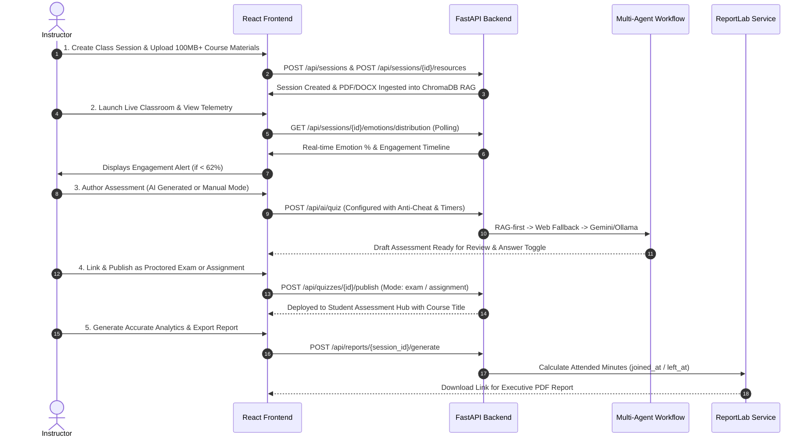
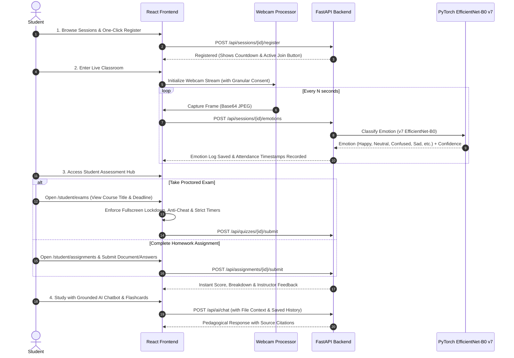
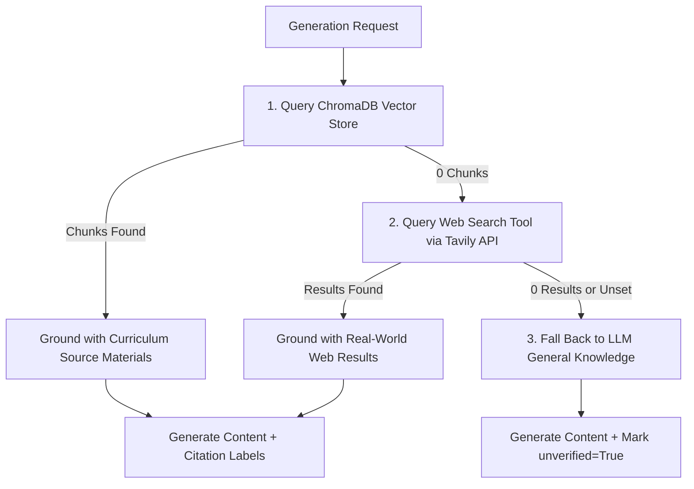
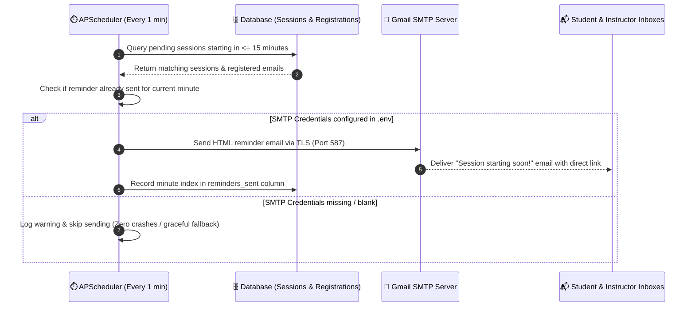

# 🎓 EduSense — Multi-Agent AI Education Platform

[](https://www.linkedin.com/in/adel-mohamed-noufal-3a9440348/)
[](https://www.linkedin.com/in/adel-mohamed-noufal-3a9440348/)
[-EE4C2C.svg?logo=pytorch)](https://github.com/adel-noufal/Edusense)
[](https://github.com/adel-noufal/Edusense)
[](https://github.com/adel-noufal/Edusense)
[](LICENSE)
[](CHANGELOG.md)
[](https://github.com/adel-noufal/Edusense/actions)

> **EduSense** is a fully local, multi-agent AI Education Platform designed for adaptive learning, automated assessment & lesson authoring, real-time webcam emotion telemetry, grounded multi-source RAG, interactive video generation, and proctored student evaluations.
>
> 👤 **Author:** [Adel Mohamed Noufal](https://www.linkedin.com/in/adel-mohamed-noufal-3a9440348/)  
> 🔗 **LinkedIn:** [https://www.linkedin.com/in/adel-mohamed-noufal-3a9440348/](https://www.linkedin.com/in/adel-mohamed-noufal-3a9440348/)  
> 🔗 **GitHub Repository:** [https://github.com/adel-noufal/Edusense](https://github.com/adel-noufal/Edusense)

---

## 🌟 Key Features & AI Architecture

EduSense features **8 specialized AI agents**. Agents 1–7 are coordinated sequentially by `EduSenseAgentWorkflow` ([`backend/app/agents/workflow.py`](backend/app/agents/workflow.py)) for post-session analytics and pedagogical improvement, while Agent 8 (RAG Knowledge Base & Chatbot) is driven on demand through a dedicated multi-source orchestrator ([`backend/app/agents/orchestrator.py`](backend/app/agents/orchestrator.py)):

1. 🎭 **Emotion Analysis Agent** — Analyzes webcam frames in real-time using a custom **v7 PyTorch EfficientNet-B0** model (**90.9% Accuracy**) with DeepFace fallback.
2. 📊 **Student Engagement Agent** — Computes real-time engagement and attention metrics from emotion distributions.
3. 💡 **Recommendation Agent** — Generates pedagogical interventions when engagement drops below threshold (< 62%).
4. 📚 **Lesson Generation Agent** — Generates structured lessons, slides, outlines, and teaching scripts grounded in curriculum RAG and web search fallback.
5. 📝 **Quiz & Exam Agent** — Generates adaptive MCQs, True/False, and short-answer questions (RAG & Web grounded) or supports full manual authoring, with instructor-configurable timers, anti-cheat lockdown, and direct deployment to student Exams/Assignments.
6. 🎴 **Flashcard Generation Agent** — Produces high-yield, pedagogically distinct study card decks across 20 distinct cognitive dimensions grounded in uploaded materials and recent web context.
7. 📄 **Report Generation Agent** — Generates executive PDF reports via `ReportLab` with actual attended-duration analytics.
8. 🧠 **RAG Knowledge Base & AI Chat Assistant** — Grounded PDF/DOCX/PPTX course material retrieval via ChromaDB vector embeddings (100MB+ support), customizable persona Chatbot (`POST /api/ai/chat`), grounded file upload (`POST /api/ai/chat/upload`), persistent conversation history, and Knowledge Base Admin Dashboard (`/instructor/knowledge-base`).

---

## 🗺️ Roadmap & Implemented Capabilities

- ✅ **Asynchronous Task Lifecycle & Dashboard Optimization**: DONE — non-blocking background analytics generation jobs (`GenerationJobContext`), tab-switch resilience, and bidirectional session content linking (lessons + quizzes) with one-click unlink support.
- ✅ **Accurate Attended-Duration Tracking**: DONE — separate tracked student attended duration (`joined_at`, `left_at`) from scheduled session duration; accurate attendance minutes and percentages calculated across all instructor reports.
- ✅ **High-Capacity Knowledge Base / RAG**: DONE — 100MB+ file upload support via chunked streaming, file format validation using magic bytes (PDF, DOCX, PPTX, TXT, MD), non-blocking background ingestion with status polling, and live document preview.
- ✅ **Crash-Resistant AI Lessons Tab**: DONE — hardened state handling, topic extraction fallbacks, and seamless rendering across online and offline failover tiers.
- ✅ **Dual-Mode Quiz Authoring & Exam Deployment**: DONE — full manual quiz/exam authoring alongside AI generation, dynamic exam settings editor (timers, fullscreen, webcam proctoring, pass percentage, back-navigation locking), and toggles for showing/hiding correct answers.
- ✅ **Pedagogically Distinct Flashcards**: DONE — eliminated repetitive card generation using a 20-dimensional pedagogical framework (definitions, mechanisms, contrasts, edge cases, mnemonics) grounded in RAG curriculum or Tavily web results.
- ✅ **Educational Video Studio & Scene Editor**: DONE — per-scene narration audio synthesis using gTTS (with tone fallback), duration-synced slide transitions, interactive player with autoplay/scrubbing, and an in-UI scene editor (`PUT /api/videos/{id}/scenes`) supporting re-rendering.
- ✅ **Customizable AI Chatbot with Grounded Uploads & History**: DONE — configurable bot identity (`chatbot_name`, `chatbot_persona`), dedicated 3rd API key support (`EDUSENSE_CHATBOT_GEMINI_API_KEY`), file context injection (`POST /api/ai/chat/upload`), and persistent sidebar conversation history.
- ✅ **Student Assessment Hub (Exams & Assignments)**: DONE — fixed student authentication token reactivity in `AuthContext`, resolved infinite loaders, populated course `session_title` on all exam/assignment cards, and added deadline-aware submission portals.
- ✅ **Hardening, Schema Alignments & Robust Key Rotation**: DONE — aligned Alembic migrations with `seed.py` for SQLite/PostgreSQL, eliminated timer race conditions and attempt resumption discrepancies in `Quiz.jsx`, and expanded Gemini key rotation to fail over on revoked/suspended keys (400/403 `API_KEY_INVALID`, 503) as well as 429 rate limits.
- ✅ **Privacy & Consent Engine**: DONE — granular webcam consent tracked separately per purpose (`emotion_detection` vs. `quiz_anti_cheat`), enforced server-side, with non-blocking platform fallback and draft policy documentation (`docs/PRIVACY_POLICY.md` and `docs/TERMS_OF_SERVICE.md`).

---

## 👨‍🏫 Instructor System Workflow



---

## 🎓 Student System Workflow



---

## 🎯 Student Assessment Hub: Exams & Assignments

EduSense provides dedicated, authenticated student portals designed to eliminate infinite loaders and display full course context:

### 1. Proctored Exams (`/student/exams`)
- **Direct Course Linking**: Displays the enrolled course name (`session_title`) alongside exam title, duration, question count, and pass threshold.
- **Anti-Cheat Enforcement**:
  - Fullscreen lockdown mode with active detection of tab switching, window blurring, and fullscreen escape attempts.
  - Dynamic user-traceable watermark overlay across the screen.
  - Optional AI-assisted proctoring via webcam for violation detection.
- **Resilient Timers**: Per-quiz and per-question timers with server-side start-time reconciliation on refresh or resumption to eliminate time-drift exploits.
- **Submission & Results**: Immediate scoring for objective questions and violation auditing for instructor review.

### 2. Homework & Assignments (`/student/assignments`)
- **Course-Grouped Views**: Lists assignments grouped by session title with due dates, point values, and submission statuses.
- **Submission Workflow**: Supports multi-format file uploads (PDF, DOCX, code files) and text submissions.
- **Feedback & Grading**: Displays graded results, rubric breakdowns, and instructor feedback remarks.

---

## 🎬 Educational Video Studio & Scene Editor

EduSense features an end-to-end automated educational video synthesis engine:

1. **Structured Script & Scene Generation**: Outlines instructional slides with headings, visual cues, bullet points, and narration scripts.
2. **Audio Narration Pipeline**: Synthesizes speech per scene using `gTTS` (with sinusoidal tone fallback) and measures exact audio duration in seconds.
3. **Synchronized HTML5 Player**: Generates a self-contained, responsive `player.html` with timed slide autoplay, audio playback, progress scrub bar, and play/pause controls.
4. **In-UI Scene Editor**: Instructors can modify scene titles, narration text, and display duration directly in the frontend (`/instructor/ai-tools` Video Tab) and trigger instant re-rendering via `PUT /api/videos/{id}/scenes`.

---

## 🤖 Customizable AI Chatbot with Grounded File Upload

The AI Chatbot (`/instructor/ai-tools` AI Chatbot Tab) provides an interactive teaching assistant:

- **Custom Identity & Persona**: Instructors can customize the chatbot name (e.g., `EduSense Mentor`) and behavioral persona via environment settings or API.
- **Dedicated 3rd API Key**: Supports `EDUSENSE_CHATBOT_GEMINI_API_KEY` to protect primary lesson/quiz generation quota from chat traffic.
- **File Upload & Grounding**: Students and instructors can upload reference documents (`.pdf`, `.txt`, `.docx`) directly into the chat session (`POST /api/ai/chat/upload`) to ground answers in specific files.
- **Persistent Conversation History**: All conversations are stored in the database (`chat_messages` table) with a collapsible sidebar for switching between past threads or deleting conversations.

---

## 🧠 Knowledge Base vs AI Chatbot — Two Different Tools

EduSense deliberately ships **two separate Q&A experiences** with different contracts:

| | **Knowledge Base** (`/instructor/knowledge-base` → AI Chat Assistant) | **AI Chatbot** (`/instructor/ai-tools` → AI Chatbot) |
|---|---|---|
| Grounding | **Strictly document-grounded (RAG-only)** | **General-purpose assistant** |
| No relevant document | Says plainly *"I couldn't find anything about that in the uploaded course materials"* and points to the Chatbot | Answers normally from model knowledge and/or live web search |
| File context | Scoped per document — each library card has an *"Ask a question about only this file"* button | Optional file attachment/context injection |
| Refusals | Refuses off-material questions honestly | Never refuses merely because no source is attached |

Both paths are protected by a user-facing answer sanitizer that strips any leaked internal prompt/guardrail text (`=== SCOPE GUARDRAIL ===`, `[System: ...]` scaffolding) before answers reach the UI — including template/offline fallbacks.

## 😊 Emotion Recognition Trial (Student Dashboard)

The student dashboard home page includes a self-contained **Emotion Recognition Trial** widget (`frontend/src/components/EmotionTrial.jsx`):

- **Live Webcam mode** — analyzes the student's expression roughly once per second and shows the detected emotion + confidence.
- **Single Photo mode** — captures one frame and returns one analysis.
- Reuses the production detection pipeline via `POST /api/emotions/analyze-trial` (same v7 EfficientNet-B0 / DeepFace agent) — trial frames are **not** written to `emotion_logs` and no class session is required.
- Respects the existing consent engine: webcam access is gated behind the `emotion_detection` consent modal before the camera is opened.

---

## 🔄 Multi-API-Key Rotation for Google Gemini

To prevent request failures caused by quota exhaustion, rate limits, or credential revocation, EduSense features an automatic API key rotation and failover engine:

### ⚙️ Configuration
You can supply multiple keys using a comma-separated variable or numbered variables:

```env
# Primary & secondary keys:
GEMINI_API_KEY=AIzaSyA1...,AIzaSyB2...

# Dedicated chatbot key (optional 3rd key):
EDUSENSE_CHATBOT_GEMINI_API_KEY=AIzaSyC3...

# OR numbered variables (automatically discovered):
GEMINI_API_KEY_1=AIzaSyA1...
GEMINI_API_KEY_2=AIzaSyB2...
GEMINI_API_KEY_3=AIzaSyC3...
```

### 🛡️ Rotation & Failover Mechanics
1. **Multi-Failure Classification (`_is_rotatable_error`)**: Automatically rotates keys not only on HTTP 429 rate limits, but also on HTTP 503 capacity errors, and HTTP 400/403 invalid/suspended key errors (`API_KEY_INVALID`, `permission_denied`, `billing_not_enabled`).
2. **Instant Failover**: If an active key fails with any rotatable error, the rotator immediately marks it exhausted and repeats the call on the next candidate key without failing user requests.
3. **Automatic Cooldown Recovery**: Exhausted keys enter an exponential cooldown (default: 60s) and automatically re-enter the active pool once the cooldown passes.
4. **Security Masking**: All logging and status inspection mask private key tokens (e.g., `AIza...4f2a`).

---

## 🌐 Grounded Retrieval Pipeline: RAG + Web Search

All content-generating agents follow a strict 3-tier retrieval hierarchy:



- **Curriculum RAG First**: Searches course PDFs and session documents in ChromaDB vector embeddings. Cites materials as `[Source: document.pdf p.N]`.
- **Web Search Fallback**: If no relevant curriculum documents exist, queries the Tavily Search API for verified, up-to-date web content. Cites sources as `[Web N: Title](url)`.
- **Graceful Offline Degradation**: If both RAG and Web Search are empty or unavailable, the agent generates content using general model knowledge, flags the result with `unverified: true`, and surfaces an unverified badge in the UI.

---

## ⚡ Smart Multi-Tier AI System (Online + Multi-Model Offline)

EduSense features an **Intelligent Automatic Failover & Task Routing System**:

```text
                   ┌─────────────────────────────────────┐
                   │          AI Agent Request           │
                   └──────────────────┬──────────────────┘
                                      │
                    ┌─────────────────▼─────────────────┐
                    │ 🌐 Gemini 2.0 Flash (Online API)  │
                    └─────────────────┬─────────────────┘
                                      │  (If Offline / Connection Fails)
                    ┌─────────────────▼─────────────────┐
                    │ 🦙 Specialized Local Ollama LLMs  │
                    │ • Translation -> Qwen 2.5 (7B)    │
                    │ • Lessons     -> Mistral (7B)     │
                    │ • Quizzes     -> Llama 3.1 (8B)   │
                    │ • Flashcards  -> Llama 3.2 (3B)   │
                    └─────────────────┬─────────────────┘
                                      │  (If Ollama Unreachable)
                    ┌─────────────────▼─────────────────┐
                    │ ⚙️ Built-in Local Templates        │
                    └───────────────────────────────────┘
```

- **Online Mode (Default):** Uses **Google Gemini 2.0 Flash** with automatic multi-key rotation for fast, high-quality generation.
- **Automatic Offline Failover:** If the internet connection drops or Gemini times out (15s limit), the system **automatically failovers** to your local **Ollama** specialized models without throwing errors.
- **Specialized 4-Model Routing:**
  - 🌐 **Translation / Multilingual:** Uses `qwen2.5` (Best 7B model for Arabic & 29+ non-English input processing).
  - 📚 **Lessons:** Uses `mistral` (Best 7B model for structured lessons, slide outlines & teaching scripts).
  - 📝 **Quizzes:** Uses `llama3.1` (Best 8B reasoning for assessment questions & distractors).
  - 🎴 **Flashcards & General:** Uses `llama3.2` (Lightweight 3B model for fast card generation).
- **Template Fallback:** If Ollama is also unreachable, built-in deterministic templates prevent application crashes.

---

## 📊 Emotion Model Benchmark (v7 EfficientNet-B0 — 90.9%)

Our custom trained **v7 PyTorch EfficientNet-B0** model achieves **90.9% overall accuracy**:

| Emotion Class | Accuracy | Sample Size (n) | Benchmark Winner |
| :--- | :--- | :--- | :--- |
| **Angry** | **88.6%** | n=1210 | 🏆 **v7** |
| **Disgust** | **94.7%** | n=226 | 🏆 **v7** |
| **Fear** | **87.3%** | n=1185 | 🏆 **v7** |
| **Happy** | **94.1%** | n=715 | 🏆 **v7** |
| **Neutral** | **95.5%** | n=378 | 🏆 **v7** |
| **Sad** | **94.3%** | n=297 | 🏆 **v7** |
| **Surprise** | **96.4%** | n=193 | 🏆 **v7** |
| **Overall Model** | **90.9%** | **Total Benchmark** | 🏆 **v7 EfficientNet-B0** |

---

## 🔒 Privacy & Consent

Before any webcam capture starts, students must explicitly opt in — consent is tracked **separately per purpose**:

- **`emotion_detection`** — real-time emotion analysis during live sessions.
- **`quiz_anti_cheat`** — camera-based proctoring during timed quizzes.

Consent is enforced **server-side**, declining never blocks access to non-camera platform areas, and users can withdraw consent at any time. See [`docs/PRIVACY_POLICY.md`](docs/PRIVACY_POLICY.md) and [`docs/TERMS_OF_SERVICE.md`](docs/TERMS_OF_SERVICE.md).

---

## 🚀 Quick Start Guide

### 1. Backend Setup (FastAPI + SQLAlchemy)

```bash
cd backend
python -m venv .venv
.venv\Scripts\activate      # On Linux/macOS: source .venv/bin/activate
pip install -r requirements.txt
copy .env.example .env      # Configure your keys in .env
python migrate.py upgrade   # Apply all Alembic database migrations
uvicorn app.main:app --reload
```

### 2. Frontend Setup (React + Vite + TailwindCSS)

```bash
cd frontend
npm install
npm run dev
```

Open `http://localhost:5173` in your browser.

**Default Test Credentials:**
- **Instructor:** `instructor@edusense.local` / `Password123`
- **Student:** `student@edusense.local` / `Password123`

> ⚠️ **Production note:** set `EDUSENSE_DISABLE_DEFAULT_ACCOUNTS=true` in `.env` to prevent default seed accounts from being created in production deployments.

---

## 🦙 Running Ollama Offline (Multi-Model Setup)

1. Download Ollama from [ollama.com](https://ollama.com).
2. Pull the 4 specialized models in your terminal:
   ```bash
   ollama pull qwen2.5     # Translation & Multilingual (7B)
   ollama pull mistral     # Lessons & Scripts (7B)
   ollama pull llama3.1    # Quizzes & Assessments (8B)
   ollama pull llama3.2    # Flashcards & General Fallback (3B)
   ```
3. Update `backend/.env`:
   ```env
   EDUSENSE_AI_PROVIDER=ollama
   ```

---

## 📧 Email Notifications Setup & Workflow (Gmail SMTP)

EduSense includes an automated background scheduler (`APScheduler`) that queries upcoming sessions every minute and sends automated HTML reminder emails to students and instructors 15 to 1 minutes before class starts.



### ⚙️ Configuration in `backend/.env`:

```env
# Email SMTP notifications:
EDUSENSE_SMTP_HOST=smtp.gmail.com
EDUSENSE_SMTP_PORT=587
EDUSENSE_SMTP_USER=your-email@gmail.com
EDUSENSE_SMTP_PASSWORD=your-16-character-app-password
```
*(Generate an App Password via Google Account → Security → 2-Step Verification → App Passwords).*

---

## 📁 Project Architecture

```text
frontend/     React + Vite frontend, interactive dashboards, webcam capture
  src/
    components/ Shared UI widgets, Layout, Charts, ConsentModal, SessionPickerFields...
    context/    AuthContext (token reactivity), GenerationJobContext, ToastContext...
    pages/      Dashboard, LiveSessionRoom, Quiz, StudentExams, StudentAssignments, KnowledgeBase, AITools...
backend/      FastAPI REST backend, PostgreSQL / SQLite ORM, JWT auth
  app/
    agents/   8 Specialized AI agents + orchestrator + scope guardrails + RAG/Web tools
    api/      REST routes (auth, sessions, ai, quizzes, assignments, reports, rag, users, admin)
    core/     Settings, scheduler, security, audit logging
    db/       Session engine, seed.py with safe DDL migrations
    models/   SQLAlchemy ORM models (Users, Quizzes, Assignments, VideoProjects, ChatMessages...)
    schemas/  Pydantic schemas with strict validation
    services/ Gemini client (with failover rotation), Ollama runner, RAG service, Video studio, Export
  migrations/ Alembic migrations tracking schema revisions up to c59128f_harden_schema_task10
docs/         Architecture blueprints, workflow flowcharts, Privacy Policy, Terms of Service, HTTPS setup
```

---

## 👨‍💻 Author & Contact

Developed by **[Adel Mohamed Noufal](https://www.linkedin.com/in/adel-mohamed-noufal-3a9440348/)**  
🔗 **LinkedIn:** [https://www.linkedin.com/in/adel-mohamed-noufal-3a9440348/](https://www.linkedin.com/in/adel-mohamed-noufal-3a9440348/)  
🐙 **GitHub:** [https://github.com/adel-noufal](https://github.com/adel-noufal)
