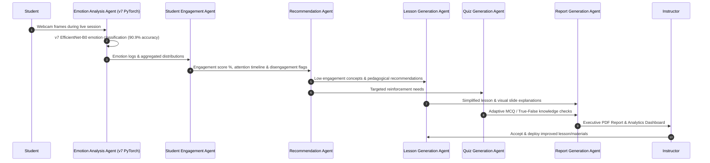

# EduSense Multi-Agent System Workflows

👤 **Author:** [Adel Mohamed Noufal](https://www.linkedin.com/in/adel-mohamed-noufal-3a9440348/)
🔗 **LinkedIn:** [https://www.linkedin.com/in/adel-mohamed-noufal-3a9440348/](https://www.linkedin.com/in/adel-mohamed-noufal-3a9440348/)
📦 **Repository:** [https://github.com/adel-noufal/Edusense](https://github.com/adel-noufal/Edusense)

---

## âš¡ Smart Multi-Tier AI Provider Task Router Diagram

```
                       ┌─────────────────────────────────────┐
                       │          AI Agent Request           │
                       └──────────────────┬──────────────────┘
                                          │
                        ┌─────────────────▼─────────────────┐
                        │ 🌐 Gemini 2.0 Flash (Online API)  │
                        └─────────────────┬─────────────────┘
                                          │  (If Offline / Connection Fails)
                        ┌─────────────────▼─────────────────┐
                        │ 🦙 Specialized Local Ollama LLMs  │
                        │ • Translation -> Qwen 2.5 (7B)    │
                        │ • Lessons     -> Mistral (7B)     │
                        │ • Quizzes     -> Llama 3.1 (8B)   │
                        │ • Flashcards  -> Llama 3.2 (3B)   │
                        └─────────────────┬─────────────────┘
                                          │  (If Ollama Unreachable)
                        ┌─────────────────▼─────────────────┐
                        │ ⚙️ Built-in Local Templates        │
                        └───────────────────────────────────┘
```

---



---

## 👨‍🏫 Instructor Workflow
1. **Create & Schedule Session**: Set lesson topic, date, start time, and target student group.
2. **Monitor Live Dashboard**: Real-time webcam emotion feedback (Happy, Neutral, Sad, Surprised, Confused, Disengaged) displayed via interactive Recharts.
3. **Receive AI Recommendations**: Triggers pedagogical suggestions when engagement drops below threshold (<62%).
4. **Export Executive PDF Report**: Automated post-session PDF export via ReportLab summarizing class performance and reinforcement materials.

---

## 🎓 Student Workflow
1. **Join Classroom**: Access scheduled sessions and launch live room interface.
2. **Real-time Engagement Stream**: Webcam frames stream in background to emotion analysis engine.
3. **Adaptive AI Study Tools**: Access AI-generated flashcards, practice quizzes, and lesson slides.
